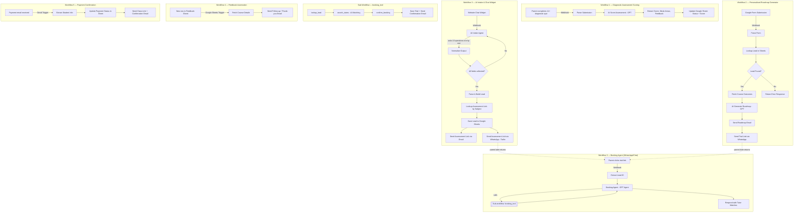

# ClassMatch AI 🎓🤖
### An End-to-End, AI-Powered Lead-to-Enrollment Automation System for Tutoring Businesses

ClassMatch AI is a fully automated, AI-driven customer acquisition and operations pipeline built for a tutoring/coaching business (11+ exam prep, music, chess, GCSE, and other subjects). It takes a prospective parent from the **first chat message** all the way to **diagnostic assessment → personalised learning roadmap → tutor matching → trial booking → payment confirmation → feedback collection**, with almost zero manual intervention.

The entire system is built on **n8n** as the orchestration/automation backbone, with **OpenAI (GPT via LangChain nodes)** powering the conversational agents, scoring, tutor-matching logic, and content generation, and **Google Sheets** acting as the lightweight CRM / database.

---

## 🚀 Why This Project Exists

Tutoring businesses typically lose leads because of slow manual follow-up: someone fills a form, and then waits hours (or days) for a human to call, assess their child, recommend a course, and schedule a trial. ClassMatch AI compresses that entire journey into an automated, real-time conversation-driven pipeline — a parent can go from "just curious" to "trial booked and confirmed" in a single sitting, without any staff member touching a keyboard.

---

## 🧩 System Architecture

The system is composed of **5 interconnected n8n workflows** plus **1 reusable sub-workflow (tool)**, all sharing a single Google Sheet as the source of truth.



---

## 🔍 Detailed Workflow Breakdown

### **Workflow 1 — Diagnostic Assessment Scoring**
- **Trigger:** Webhook, fired when a student submits answers to the 11+ diagnostic assessment.
- **Logic:**
  - `Parse Form Submission` extracts `lead_id`, `submission_id`, and the question/answer JSON.
  - `AI Score Assessment` (GPT, temperature 0.2) acts as an **expert 11+ exam marker** — it receives the full Q&A JSON (question, student answer, correct answer, topic) and returns a strict structured output:
    ```
    SCORE: <n>
    TOTAL: <n>
    WEAK_AREAS: <comma-separated topics>
    FEEDBACK: <one-sentence summary>
    ```
  - `Extract Score + Merge` (Code node) parses this plain-text response with regex into clean JSON fields.
  - The result is written back to the **Google Sheet** (assessment score, weak areas, AI feedback, status).

### **Workflow 2 — Personalised Learning Roadmap Generator**
- **Trigger:** Webhook fired by a Google Form submission (post-assessment questionnaire).
- **Logic:**
  - Looks up the lead record in Sheets to confirm it exists (`Lead Found?` branch — returns a graceful error response if not).
  - Pulls the relevant **course outcomes** for the student's subject/course from a `Subject_details` sheet and deduplicates them (`outcome_lookup` node).
  - `AI Generate Roadmap` (GPT, temperature 0.7) acts as an **expert 11+ tutor & curriculum planner**. It's fed the child's name, age, year group, subject, exam timeline, assessment score, weak areas, AI feedback, learning challenges, session preference, and the exact course outcomes — and generates a warm, structured, personalised roadmap email covering:
    1. Assessment Summary (translating the score into a confidence level)
    2. Key Weak Areas & why they matter for the exam
    3. How the course specifically addresses those weak areas
  - The roadmap is emailed to the parent (Gmail node) **and** the trial-booking link is sent via **WhatsApp (Twilio)** in parallel, with a Merge node waiting for both to complete before updating the sheet status.

### **Workflow 3 — Conversational Intake Agent + Booking Agent**
This is the conversational core of the system, split into two cooperating AI agents:

**a) AI Intake Agent** (website chat widget)
- A LangChain **Agent** node with conversation memory (Window Buffer Memory) that collects **10 structured fields** from the parent, **one question at a time**, never skipping or assuming a field:
  `child_name → child_age → email → contact_no → year_group → subject → course → availability → session preference (1:1 / Small Group) → challenges`.
- Subjects are constrained to a fixed list (Piano, Vocals, Guitar, Chess, Art, Music, GCSE, English, Math).
- When a subject is chosen, the agent has a **Google Sheets tool** to dynamically pull the *real* course names for that subject — it is explicitly instructed never to invent course names.
- Once all 10 fields are confirmed, the lead is parsed, saved to Google Sheets, and the assessment link is dispatched via **email + WhatsApp simultaneously**.

**b) Booking Agent** (triggered when the parent clicks their personal trial-booking link)
- Receives a `START:[leadId]` trigger and, without speaking to the parent first, silently:
  1. Calls the `booking_tool` sub-workflow with `action=lookup_lead` to pull the lead's full profile.
  2. Calls `booking_tool` with `action=search_tutors` to find matching tutors.
- If matches are found, it greets the parent by the child's name and presents **up to 3 tutor options** (name, type, trial date/time, and a short AI-generated match reason) — deliberately withholding full tutor schedules to keep the conversation focused.
- If the parent replies `1`, `2`, or `3`, the agent calls `booking_tool` with `action=confirm_booking`, which finalises the trial.
- If no exact match exists, it proposes 2–3 alternative slots, always prioritising subject match over time match.

### **Sub-Workflow — `booking_tool`** (reusable tool called by the Booking Agent)
A single, action-routed sub-workflow (Execute Workflow trigger + Switch node) exposing three actions to the parent-facing agent:
| Action | What it does |
|---|---|
| `lookup_lead` | Fetches the lead's saved profile from Google Sheets by Lead ID |
| `search_tutors` | Pulls the full tutor roster and runs it through an **AI matching model** (GPT) that scores tutors against the student's subject, availability, and weak points, then returns the top matches with human-readable match reasons |
| `confirm_booking` | Writes the confirmed trial to a `Trials` sheet, updates the lead's status, and sends a confirmation email to the parent |

This tool-based architecture keeps the conversational agent's prompt clean while all business logic and data access stay centralised and testable in one place.

### **Workflow 4 — Feedback Automation**
- **Trigger:** Google Sheets Trigger, polling every minute for new rows in the `Feedback` tab.
- **Logic:** Cross-references the course taken, then automatically sends a personalised follow-up/acknowledgement email — closing the loop after a trial or session without manual admin work.

### **Workflow 5 — Payment Confirmation & Class Activation**
- **Trigger:** Gmail Trigger, watching for incoming payment-notification emails.
- **Logic:**
  - Extracts the student reference from the payment email.
  - Looks up the student's trial/course record and marks `payment_sent = TRUE` in the `Trials` sheet.
  - Sends a confirmation email containing the class schedule and class link, and separately notifies internal records — turning a raw payment email into a fully activated enrolment automatically.

---

## 🗂️ Data Model (Google Sheets as CRM)

A single spreadsheet (`lead_data_google_sheet_template`) acts as the shared database across all workflows, with the following tabs:

| Sheet | Purpose |
|---|---|
| **Leads** | Master record per parent/child — contact info, subject, course, availability, preference, challenges, assessment score, weak areas, status flags |
| **Subject_details** | Maps subjects → available courses → course outcomes (used to keep AI grounded, never hallucinating course names) |
| **Trials** | Booked trial sessions — tutor assigned, date/time, payment status, class link |
| **course_details** | Reference data for course metadata used in confirmation emails |
| **Feedback** | Post-session feedback form responses (drives Workflow 4) |
| **Tutors** | Tutor roster with subject specialities and availability, used for AI-based matching |

---

## 🛠️ Tech Stack

| Layer | Technology |
|---|---|
| Orchestration / Automation | **n8n** (self-hosted or cloud) |
| Conversational AI Agents | **LangChain Agent nodes** (`@n8n/n8n-nodes-langchain`) with Window Buffer Memory |
| LLM | **OpenAI GPT models** (via `lmChatOpenAi` / `openAi` nodes) |
| Database / CRM | **Google Sheets** (Sheets node + Sheets Trigger) |
| Messaging | **Gmail** (transactional & trigger-based emails), **Twilio** (WhatsApp messaging) |
| Front-end entry points | Website chat widget (Webhook), Google Form (assessment intake) |
| Backend glue logic | n8n **Code nodes** (JavaScript) for parsing, merging, and formatting |

---

## ⚙️ Setup & Deployment

### Prerequisites
- An [n8n](https://n8n.io) instance (self-hosted via Docker, or n8n Cloud)
- A Google Cloud project with **Google Sheets API** and **Gmail API** enabled
- An **OpenAI API key**
- A **Twilio** account with WhatsApp Business API sandbox/production access
- A copy of the shared Google Sheet (Leads, Trials, Subject_details, course_details, Feedback, Tutors tabs)

### Steps
1. Clone this repository.
2. Import both workflow files into n8n:
   - `Full_workflow_classmatch_AI.json` → the 5 main workflows (they live inside one n8n workflow file, separated by sticky notes/sections).
   - `subflow_classmatch_AI.json` → the reusable `booking_tool` sub-workflow (must be imported separately and referenced by ID from the Booking Agent's Tool Workflow node).
3. Reconnect all **credentials** in n8n (Google Sheets OAuth2, Gmail OAuth2, OpenAI API key, Twilio Account SID/Auth Token) — these are stripped from the exported JSON for security.
4. Replace the placeholder Google Sheet document ID with your own spreadsheet ID in every Google Sheets node.
5. Activate the workflows and copy each Webhook's production URL into:
   - Your website's chat widget (Intake Agent webhook)
   - Your Google Form's submission handler (Roadmap webhook)
   - Your trial-booking landing page link (Booking Agent webhook)
6. Test end-to-end with a dummy lead before going live.

> ⚠️ **Security note:** Never commit real API keys, OAuth tokens, spreadsheet IDs, or phone numbers to the repository. Use n8n's built-in credential manager, and consider adding a `.gitignore` / sanitising the exported JSON before pushing.

---

## ✨ Key Highlights / What Makes This Project Interesting

- **Multi-agent architecture**: two distinct LangChain agents (Intake Agent and Booking Agent) with separate memory, each backed by a strict, guardrailed system prompt to prevent hallucination (e.g., never inventing course names or tutor availability).
- **Tool-calling pattern**: the Booking Agent doesn't touch the database directly — it calls a single external `booking_tool` sub-workflow with a clean action-based interface (`lookup_lead`, `search_tutors`, `confirm_booking`), which is a clean, reusable, testable pattern for production n8n agents.
- **AI-as-grader**: GPT is used with strict output-format constraints (temperature 0.2) to reliably score exam answers and extract weak areas as structured text, parsed downstream with regex.
- **AI-as-writer**: a second GPT call (temperature 0.7) turns that structured diagnostic data into a warm, human-sounding personalised roadmap — balancing consistency (via strict field templating) with natural language quality.
- **Omnichannel delivery**: every key message (assessment link, roadmap, trial confirmation) goes out over **both email and WhatsApp in parallel**, using Merge nodes to synchronise before updating status — maximising the chance a parent actually sees it.
- **Fully event-driven**: five independent triggers (2 webhooks for chat, 1 webhook for form, 1 Sheets trigger, 1 Gmail trigger) mean the system reacts in real time to parent actions, form submissions, and even incoming payment emails, with no polling or manual checks required by staff.

---

## 📌 Future Improvements
- Replace Google Sheets with a proper relational database (e.g., PostgreSQL/Airtable) as lead volume scales.
- Add a analytics dashboard (conversion funnel: intake → assessment → roadmap → trial → payment).
- Add automated retry/reminder flows for parents who don't complete the assessment or don't respond to the booking agent.
- Add a Vapi-based voice AI assistant as an additional channel alongside the chat/WhatsApp intake (in progress).

---

## 👤 Author
**Kazi Osman** — AI Developer
Built as a real-world, production-style automation project combining LLM agents, RAG-style grounded data lookups, and n8n workflow orchestration for a tutoring business client.
